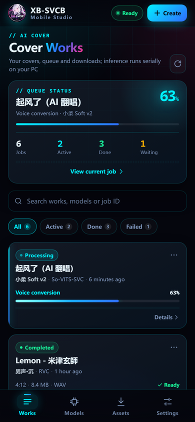
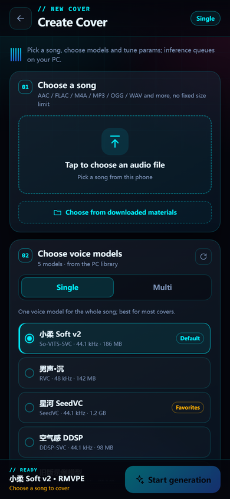
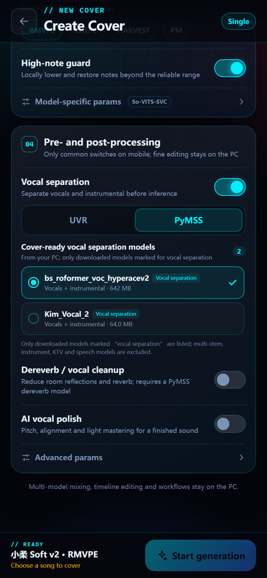

# XB-SVCB Mobile

XB-SVCB 的 Android 伴生客户端，现已从桌面端仓库独立，拥有独立 Git 仓库。

- 本仓库：[https://github.com/SDIJF1521/XB-SVCB-Mobile](https://github.com/SDIJF1521/XB-SVCB-Mobile)
- 桌面端项目：[https://github.com/SDIJF1521/xb-svcb](https://github.com/SDIJF1521/xb-svcb)
- 桌面端 API 文档：[https://github.com/SDIJF1521/xb-svcb/blob/dev/docs/api.md](https://github.com/SDIJF1521/xb-svcb/blob/dev/docs/api.md)
- 独立许可：GPL-3.0-only

<p align="center">
  
  
  
</p>

## 这不是桌面端的替代品

手机端只做三件事：**看作品、建任务、拿素材**。以下能力不在本项目中：

- 音频编辑器、MIDI、完整时间轴编排；
- 自定义工作流画布、实时变声；
- 本地推理、模型训练、复杂参数批量调试。

多模型翻唱只提供简化的分段与合唱编辑；逐句精细时间轴仍建议在电脑端完成。

## 功能

### 作品与任务

- 作品/任务列表、状态筛选（全部 / 进行中 / 已完成 / 失败）与关键词搜索。
- 队列概览：当前任务、整体进度、活动步骤、排队数量；有任务时 3.5 秒、
  空闲时 9 秒轮询，页面隐藏时暂停。
- 任务详情：模型、框架、前期处理、生成流程、AI 美声、任务 ID 与步骤时间线。
- 成品试听：按需缓存到应用私有目录，支持播放 / 暂停 / 拖动。
- 下载成品、UVR 伴奏与转换后人声到手机「下载 / XB-SVCB」。
- 重命名、失败重试、删除任务；断线自动回到连接页并保留地址与 Key。

### 创建翻唱

- 从手机文件选择 AAC / FLAC / M4A / MP3 / OGG / OPUS / WAV 等音频。
- **从已下载素材选择**：列出电脑端「资源获取」的已下载歌曲，服务端复制为上传件。
- 原生流式上传，显示百分比与字节数，上传完成后才创建任务。
- 单模型 / 多模型：读取音频时长后平均分段；可逐段修改起止、增减段落，
  同一段多选模型即生成合唱。
- **歌曲名与时间轴歌词**：歌名自动填入或手改；从网易云 / QQ 音乐 / 酷我
  搜索候选、获取时间轴歌词，逐句生成分段并循环指派模型，之后可继续手动调整。
- 音高偏移、F0 算法、高音保护、模型专用参数与 AI 美声。
- **PyMSS 人声分离**：只显示已下载、能够提供人声的模型；
  双人/二重唱、合唱、男女声、语音/说话人、多轨、单乐器、纯伴奏模型会被过滤。
  人声/伴奏双向模型（如 `instvox_duality`）即使目录 purpose 为空，
  只要 `target_stems` 含 `vocals + instrumental` 也会保留；卡拉OK/和声的
  `backing_vocal` 模型允许参与；纯 `Inst` 伴奏模型仍然排除。
  选择器为卡片列表，显示分类、输出音轨与体积，模型多时支持搜索。

### 模型与素材

- 声音模型：搜索、框架筛选、收藏、设为默认、重命名、检查、删除。
- 模型站：搜索 ModelScope 中由本软件上传的声音模型，显示本地安装状态，
  一键下载导入并轮询进度。
- PyMSS Studio：完整目录、分类、用途筛选、下载/重下/删除。
- 素材中心：在线搜索歌曲或伴奏并**下载到电脑端素材库**；列出电脑端已下载
  素材，可「用于翻唱」或删除；翻唱作品不会出现在素材页。
- 设置：连接、服务版本、推理设备、界面语言、三套主题、下载目录、关于。

## 技术栈

- Vue 3 + TypeScript + Pinia + Vite，移动端 SPA。
- Android WebView 壳，无 Gradle / Android Studio 依赖。
- 原生桥 `XBNative`：HTTP（支持 PATCH）、上传、下载、音频缓存、文件选择、
  音频时长探测、配置存储。
- 前端构建为单一 IIFE，`tools/postbuild.js` 把 `type="module"` 改为 `defer`，
  以适配 `file://` 加载。
- APK 使用 `aapt2` + `javac` + `d8` + `zipalign` + `apksigner` 手工构建并签名。
- 自适应布局：以 390×844 为基准的 `clamp()` 尺寸令牌，窄屏收紧、宽屏封顶，
  矮屏压缩纵向节奏（见 [docs/UI.md](docs/UI.md)）。

## 界面自适应

页面尺寸不写死：所有页面共用 `web/src/style.css` 里的一组尺寸令牌，
以 390×844 为 1× 基准随屏宽缩放，320px 窄屏收紧、390–440px 陆续封顶；
屏幕高度 ≤700px 时压缩标题、控件与间距，≤560px 再压一档。

- 连接页与其它页面使用同一套字号与边距（标题 24px、页面边距 16px、卡片 14px），
  不再单独放大；360×640 及以上可完整一屏放下，320×568 与横屏可滚动。
- 页头、底部标签栏、输入框、按钮、卡片圆角共用令牌，缩放规则一致。
- 关闭安卓 WebView 的字体放大（`text-size-adjust: 100%`），各机型字号一致。

尺寸令牌、断点与新增页面的接入方式见 [docs/UI.md](docs/UI.md)；
多机型截图与测量见下文「开发与本地 Mock」。

## 目录

```text
XB-SVCB-Mobile/
├─ android/
│  ├─ AndroidManifest.xml
│  ├─ res/
│  └─ java/cn/xbsvcb/mobile/
│     ├─ MainActivity.java
│     ├─ NativeBridge.java
│     └─ SimpleHttp.java
├─ web/
│  ├─ src/                 # Vue 应用
│  ├─ public/logo.png
│  ├─ build.mjs            # 独立 Vite 构建入口
│  └─ package.json
├─ tools/
│  ├─ mock-server.js       # 本地 API mock
│  ├─ shoot.js             # Edge + Puppeteer 截图
│  ├─ shoot-sizes.js       # 多机型截图与布局测量
│  ├─ prepare-sdk.ps1      # 下载 Android SDK
│  ├─ make-icons.py
│  └─ postbuild.js
├─ docs/
│  ├─ API.md               # 依赖的电脑端接口
│  ├─ UI.md                # 界面自适应与布局规范
│  └─ screenshots/
├─ build-apk.ps1
└─ README.md
```

## 环境要求

- Windows 10/11；
- Node.js 20+ 与 npm；
- JDK 17（`javac`、`java` 在 PATH 中）；
- Android SDK：`platforms/android-35`、`build-tools/35.0.0`（首次可用脚本下载）；
- 电脑端 XB-SVCB 已启动 FastAPI，且手机与电脑在同一局域网。

首次准备：

```powershell
pwsh -File tools/prepare-sdk.ps1
cd web
npm install
cd ..
```

## 构建 APK

```powershell
pwsh -File build-apk.ps1
```

输出：

```text
dist/XB-SVCB-Mobile-0.1.2.apk
```

构建脚本会：

1. 构建 `web/dist` 并执行 postbuild；
2. 用 `aapt2` 编译/链接资源与清单；
3. 编译 Java、转换为 DEX；
4. 写入 `assets/www`、对齐、签名并校验。

常用参数见脚本头部，例如跳过前端构建、跳过签名检查。首次构建会在
`.keystore/` 生成自签名密钥；该目录已被忽略，请勿提交。

安装：

```powershell
adb install -r dist/XB-SVCB-Mobile-0.1.2.apk
```

或直接把 APK 传到手机侧载安装。

## 连接电脑端

1. 电脑端打开「资料库 → API 接入」，启动服务并切换到局域网模式；
2. 手机填 `http://电脑局域网IP:8760` 与 `XB-SVCB-…` Key；
3. 连接成功后进入作品页。

API 默认端口 8760，但以电脑端页面显示为准。地址与 Key 只保存在应用私有存储；
局域网 HTTP 为明文传输，请勿把端口直接映射到公网。

## 电脑端 API 依赖

移动端依赖的接口、参数与约束见 [docs/API.md](docs/API.md)。新增的素材、
歌词、时长与在线下载接口需要更新并重启桌面端：

- [app/api/http_server.py](https://github.com/SDIJF1521/xb-svcb/blob/dev/app/api/http_server.py)
- [docs/api.md](https://github.com/SDIJF1521/xb-svcb/blob/dev/docs/api.md)

FastAPI 自动文档：`http://电脑IP:8760/docs`。

## 开发与本地 Mock

```powershell
node tools/mock-server.js 8788
cd web
npm run dev
```

打开：

```text
http://127.0.0.1:5173/?server=http://127.0.0.1:8788&key=demo-key
```

Mock 覆盖任务、模型、素材、歌词、模型站、PyMSS 与上传流程。真实后端联调时，
把 `server`/`key` 换成电脑端地址与 Key，或安装 APK 后填写。

构建前端：

```powershell
node web/build.mjs
node tools/postbuild.js
```

自动截图（需要 Edge 与 `tools/node_modules` 中的 `puppeteer-core`）：

```powershell
node tools/shoot.js tasks create models pymss settings
```

截图写入 `.screenshots/`，已被忽略。场景列表见 `tools/shoot.js`。

多机型自适应校验（同一套 mock 服务，320×568 / 360×640 / 360×780 /
390×844 / 412×915 / 横屏 780×360）：

```powershell
node tools/shoot-sizes.js current connect tasks settings models materials create
```

截图与 `report.json` 写入 `.screenshots/sizes/<标签>/`，测量项包括标题字号、
卡片内边距、纵向溢出与横向溢出，判据见 [docs/UI.md](docs/UI.md#验证)。

## 国际化

- 支持简体中文 / English / 日本語。
- 英文下导航、作品、模型、素材、设置、创建页及模型参数、PyMSS 选择器已覆盖；
  模型名、歌曲名、作品名等用户内容保留原文。
- 日文目前覆盖导航与设置页，其余页面仍为中文。
- 新增文案时优先写入 `web/src/i18n/index.ts`；零散旧文案由
  `web/src/i18n/auto.ts` 的中文→英文词表兜底。

## 测试与验证

- 后端契约：`python -m pytest ../翻唱工具/app/tests/test_http_api.py -q`。
- 前端构建：`node web/build.mjs`。
- 浏览器实测：390×844、`file://` 构建产物加载、连接、任务、创建、多模型、
  歌词分段、素材下载到电脑、模型站、PyMSS 选择器、设置与语言切换。
- 自适应布局：320×568、360×640、390×844、412×915、横屏 780×360 逐页截图，
  各页面均无横向溢出；连接页在 360×640 及以上完整一屏，其余内容页按需滚动。
- 英文界面逐页扫描：仅剩用户内容与电脑端返回的错误文本为中文。
- APK 签名 v1/v2/v3 与 `zipalign` 校验。
- 未在真实 Android 手机上验证文件选择器、DownloadManager 与 `file://` 音频播放，
  首次安装请在真机确认这三项。

## 已知边界

- 电脑端 API 版本过旧时，素材/歌词接口会返回 404；客户端会提示更新后端并重启。
- 电脑端返回的具体任务错误可能仍为中文，这是后端数据，不是界面词表缺失。
- 局域网 HTTP 为明文传输；应用不记录 API Key 到日志，`allowBackup=false`。
- APK 为本地自签名，仅用于侧载，不用于应用商店分发。

## 许可

GPL-3.0-only。见 [LICENSE](LICENSE)。
